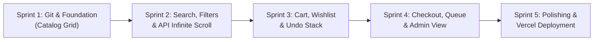

# Weekly Sprint Plan: Bookstore Full Stack Project

This sprint roadmap provides a step-by-step weekly milestone plan designed for beginners to progress smoothly from setup to live deployment.

---

### Sprint 1: Git Environment & Book Catalog Foundation
- **Goal:** Set up version control, project boilerplate, Ant Design theming, and initial catalog grid.
- **Tasks:**
  1. Initialize Git repository with `main`, `develop`, and `.gitignore`.
  2. Setup Next.js 14 with TypeScript and Ant Design 5.
  3. Create core TypeScript interfaces (`Book`, `Genre`, `Author`).
  4. Create curated books dataset (Atomic Habits, To Kill a Mockingbird, Dune, 1984, etc.).
  5. Build the responsive `BookCard` component and homepage catalog layout.
- **Deliverables:** Working homepage showing curated book cards with titles, authors, prices, and cover thumbnails.

---

### Sprint 2: Search, Filters & Public API Infinite Scroll
- **Goal:** Implement dynamic client search, multi-category filters, price range selector, and Gutendex infinite scroll.
- **Tasks:**
  1. Build `FilterBar` component using Ant Design `Input.Search`, `Select`, and `Slider`.
  2. Implement instant filtering logic with `filter()` and sorting with `sort()`.
  3. Build the Infinite Scroll feature using `IntersectionObserver` fetching from Gutendex API (`https://gutendex.com/books/`).
  4. Add network error handling, skeleton loading, and retry mechanisms.
- **Deliverables:** Search and filter bar that instantly narrows down books, plus infinite scroll feed for thousands of classical books.

---

### Sprint 3: Shopping Cart, Wishlist & DSA Operations
- **Goal:** Build the interactive shopping cart and wishlist powered by DSA fundamentals (Stack for Undo, Set for unique wishlist).
- **Tasks:**
  1. Create `CartContext` for centralized cart state management.
  2. Implement Add to Cart, quantity change, and remove item actions.
  3. Compute cart subtotals and grand totals using functional `reduce()`.
  4. Build Undo functionality using a `Stack` (LIFO) so users can recover removed items.
  5. Build Wishlist toggling backed by a JavaScript `Set` (guaranteeing no duplicates).
  6. Design slide-out Ant Design `Drawer` for Cart and Wishlist.
- **Deliverables:** Interactive Cart Drawer with quantity updates, live total, Undo action toast, and Wishlist drawer.

---

### Sprint 4: Order Checkout, Order Queue & Admin Dashboard
- **Goal:** Enable users to checkout orders into a FIFO queue and provide an Admin dashboard to manage books and orders.
- **Tasks:**
  1. Create Checkout Modal with Ant Design Form validation (Name, Email, Delivery Address).
  2. Build Order Queue ($FIFO$) where new orders are enqueued with unique IDs and positions.
  3. Create Next.js API Route Handlers (`/api/books`, `/api/orders`) for backend simulation.
  4. Build Admin view displaying inventory statistics, Add New Book form, and Order queue status table.
- **Deliverables:** Full checkout experience showing Order ID and Queue position, plus complete Admin inventory panel.

---

### Sprint 5: Quality Assurance, Showcase & Vercel Deployment
- **Goal:** Test all user flows, optimize production build, and deploy the application live to Vercel.
- **Tasks:**
  1. Verify zero TypeScript errors and zero Next.js build warnings via `npm run build`.
  2. Test responsiveness across mobile, tablet, and desktop viewports.
  3. Create interactive Sprint & Roadmap visualizer modal inside the application for project showcase / presentation.
  4. Push Git repository to GitHub.
  5. Deploy to Vercel with automatic continuous deployment.
- **Deliverables:** Live Vercel deployment URL, GitHub repository, and final project presentation guide.
